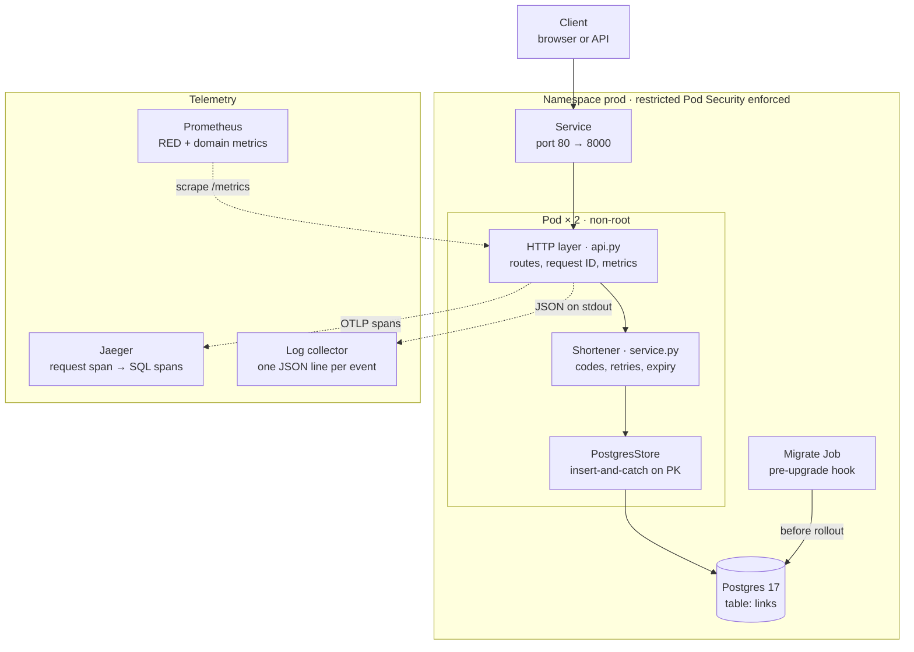

# shortly — Design Document

> Last updated 2026-10-20 for v0.1.0 / chart 0.1.1. Mirrored at
> [Claude Docs](https://claude.ai/artifact/1du93suG9M2oJJUvvQzYmS). Update both in the
> same PR as the change they describe (see `CLAUDE.md`).

## Overview

shortly is a URL shortener: `POST /links` returns a 7-character code, and `GET /{code}` redirects to the target with a 307. It is built as a production-shaped reference service, so the operational machinery around it (CI, supply chain, observability, deploys, rollback) matters as much as the feature.

**Status:** v0.1.0 released 2026-10-20 as `ghcr.io/statsguy/shortly@sha256:ef71dd3e544d…` (amd64 + arm64), with signed SLSA provenance. It deploys to local Kubernetes (kind) in `staging` and `prod` namespaces.

**Goals**

- Correct, unguessable short links with optional expiry.
- Every change gated by CI: lint, strict types, tests against real Postgres, image scan, container smoke test, Kubernetes deploy and rollback drill.
- Verifiable artifacts: an image is identified by digest and traceable to a commit, tag and workflow.
- Zero-downtime rollouts with automatic rollback, rehearsed on every PR.
- Logs, metrics and traces that link to each other.

**Non-goals (for now)**

- Custom aliases, link editing or deletion, user accounts, analytics dashboards.
- Multi-region or a managed cloud deployment (the chart is portable; the infrastructure is not built yet).
- Abuse prevention (rate limiting, malicious-URL screening).

**Scope of this doc:** the system as of v0.1.0 and chart 0.1.1. Operational procedures live in [RUNBOOK.md](RUNBOOK.md).

## Architecture

A request enters through the Kubernetes Service, crosses three in-process layers, and ends in one Postgres primary-key operation; logs, metrics and traces leave the pod on separate paths.



The layers depend inward only: `api.py` knows the `Shortener`, which knows the `LinkStore` Protocol, never Postgres. `PostgresStore` and `InMemoryStore` are interchangeable adapters that pass the same contract test suite. The migration Job runs from the same image before new pods start.

## Domain model and code generation

A `ShortLink` is a frozen Pydantic model, validated once at creation so the rest of the code can trust it.

| Field | Type | Invariant |
| --- | --- | --- |
| `code` | str | base62, 7 characters by default |
| `target` | `HttpUrl` | http or https only (`javascript:`, `ftp:` rejected) |
| `created_at` | aware datetime | naive datetimes rejected |
| `expires_at` | aware datetime or null | must be later than `created_at`; a link is expired at and after this instant |

**Codes** come from `secrets.choice` over `[0-9a-zA-Z]`. A code is a capability: whoever holds it can resolve the URL, so it must be unpredictable. `random` is a predictable PRNG and is banned by ruff rule S311.

**Collisions.** With N = 62⁷ ≈ 3.52 × 10¹² codes, the birthday bound gives P(collision among n) ≈ 1 − e^(−n²/2N):

| Links stored | P(at least one collision) |
| --- | --- |
| 10,000 | about 1.4 × 10⁻⁵ |
| 266,000 | about 1% |
| 2,200,000 | about 50% |

Collisions are therefore expected long before the space is full, and they are handled rather than prevented.

**Insert-and-catch, not check-then-insert.** `Shortener.shorten` draws a code and calls `store.add`; the store raises `CodeConflictError` atomically (the Postgres primary key), and the service retries with a fresh code up to 5 times, then raises `CodeSpaceExhaustedError` (HTTP 503). A `get` before `add` would race under concurrency. Only unique violations are retried; any other integrity error propagates as a bug.

**Injected nondeterminism.** The code generator and the clock are constructor arguments. Tests pass `scripted_codes("dup", "dup", "fresh")` and a `FakeClock` instead of patching globals. An `on_collision` hook feeds the `code_collisions_total` metric without the domain layer importing Prometheus.

## HTTP API

The HTTP layer only parses input, calls the service and maps outcomes to status codes; it holds no business logic. It is built by `create_app(shortener, base_url=..., metrics=..., tracer_provider=...)`, so tests construct it with in-memory dependencies.

| Method + path | Success | Errors | Notes |
| --- | --- | --- | --- |
| `POST /links` | 201 `{code, short_url, target, expires_at}` | 422 invalid URL or TTL; 503 code space exhausted | Body `{"url": "https://…", "ttl_seconds": 1..31536000}` (TTL optional) |
| `GET /{code}` | 307, `Location: <target>` | 404 unknown; 410 expired | Sync endpoint: blocking DB calls run in the threadpool |
| `GET /healthz` | 200 | — | Liveness: process is responsive. Never touches the DB |
| `GET /readyz` | 200 | 503 when the DB ping fails | Readiness: can this pod take traffic |
| `GET /metrics` | 200, Prometheus text | — | Should be reachable only from inside the cluster |

**307, not 301.** Browsers cache a 301 indefinitely, so an expired link would keep redirecting and future click analytics would never see repeat visits.

**Liveness vs readiness.** A database outage flips `/readyz` to 503, which removes pods from Service endpoints, while `/healthz` stays 200, so Kubernetes does not restart them. Restarting every pod during a DB outage would add a restart storm to the outage. Verified: with Postgres stopped, readiness returns 503 and liveness 200; both recover without an app restart.

**`short_url`** is built from the configured `base_url`, never from the request `Host` header, which a client controls.

Every response carries `x-request-id`. A caller-supplied ID matching `[A-Za-z0-9._-]{1,64}` is propagated; anything else is replaced with a new UUID, which prevents log injection.

## Data and migrations

One table, defined with SQLAlchemy Core in `src/shortly/db.py`; the database enforces the same invariants as the model.

```sql
CREATE TABLE links (
  code        VARCHAR(32) PRIMARY KEY,          -- uniqueness = atomic collision detection
  target      TEXT NOT NULL,
  created_at  TIMESTAMPTZ NOT NULL,
  expires_at  TIMESTAMPTZ NULL,
  CONSTRAINT expiry_after_creation CHECK (expires_at IS NULL OR expires_at > created_at)
);
```

**Access path.** Writes are single-row inserts; reads are primary-key lookups. No secondary indexes are needed yet. `PostgresStore` maps only `psycopg.errors.UniqueViolation` to `CodeConflictError`.

**Connection pool.** SQLAlchemy `QueuePool`, `pool_size` from `SHORTLY_DB_POOL_SIZE` (default 5), `pool_pre_ping=True` so a DB restart costs a reconnect, not a failed request per stale connection. One-shot processes (migrations) use `NullPool`.

**Migrations** are Alembic revisions in `migrations/versions/`. The database URL comes from the same `Settings` as the app. New revisions are formatted by ruff via a post-write hook.

Guards in the test suite:

- `alembic check` fails if `db.py` and the migrations drift apart.
- Every run downgrades to base and re-applies head.
- Integration tests run against a real `postgres:17-alpine` container (testcontainers), migrated with the real migrations.

**How migrations run in production.** A Helm `pre-install,pre-upgrade` hook Job runs `alembic upgrade head` from the release's own image before any new pod starts. A failed migration aborts the release while the old pods keep serving. It is one Job per release, never an initContainer per replica, which would race on the schema.

**Compatibility rule: expand, deploy, contract.** During a rollout, old pods serve against the new schema, and a rollback runs old code against it too. Every migration must therefore be backward compatible with the previous app version. Destructive changes (drop or rename a column) ship in a later release, after no running version reads the old shape.

## Configuration and secrets

All configuration comes from environment variables, parsed by `pydantic-settings` at startup. An invalid or missing value stops the process on boot rather than failing on the first request; the rollback drill relies on this.

| Variable | Default | Meaning |
| --- | --- | --- |
| `SHORTLY_DATABASE_URL` | required | Postgres DSN; always from a Kubernetes Secret |
| `SHORTLY_BASE_URL` | `http://localhost:8000` | Public base for `short_url` |
| `SHORTLY_DB_POOL_SIZE` | `5` | Connections per pod |
| `SHORTLY_LOG_LEVEL` | `INFO` | One of DEBUG, INFO, WARNING, ERROR |
| `SHORTLY_LOG_JSON` | `true` | `false` for human-readable local logs |
| `SHORTLY_SERVICE_NAME` | `shortly` | `service.name` on traces |
| `OTEL_EXPORTER_OTLP_ENDPOINT` | unset | Tracing is on only when set; other `OTEL_*` vars are honoured |

**Secrets** never appear in values files or the repo. The chart reads the DB URL from `database.existingSecret` (default `shortly-db`, key `url`). Locally, `scripts/cluster.sh` generates a random 32-character password per namespace; in a real cluster the Secret would come from a secret manager (External Secrets, Vault, Sealed Secrets). `.env` is git-ignored; `.env.example` is the committed template. The Docker build context is an allow-list (`.dockerignore`), so `.env` cannot reach an image layer.

## Observability

The three signals point at each other: a log line carries the request ID and trace ID, a trace contains the SQL that ran, and metrics are labelled by the same route template the logs and traces use.

**Logs.** One JSON object per line on stdout (the platform collects it; the root filesystem is read-only). uvicorn and SQLAlchemy logs are routed through the same formatter. An access line is written per request by a pure-ASGI middleware:

```json
{"ts": "2026-10-21T04:30:16.343+00:00", "level": "info", "logger": "shortly.access", "msg": "request", "request_id": "d0853a21…", "trace_id": "bb2a4793…", "span_id": "588f9536…", "method": "GET", "route": "/{code}", "status": 404, "duration_ms": 2.51}
```

Probe and scrape requests (`/healthz`, `/readyz`, `/metrics`) log at DEBUG so they don't drown real traffic.

**Metrics** (Prometheus, per-app registry):

| Metric | Type | Labels | Answers |
| --- | --- | --- | --- |
| `http_requests_total` | counter | method, route, status | Traffic and error rate |
| `http_request_duration_seconds` | histogram | method, route | Latency; buckets 5 ms to 2.5 s around a 50 ms redirect target |
| `links_created_total` | counter | — | Write volume |
| `link_resolutions_total` | counter | outcome = hit, not_found, expired | Redirect outcomes |
| `code_collisions_total` | counter | — | A rising rate means codes need to get longer |

**Cardinality rule.** The `route` label is the route template (`/{code}`), never the raw path. Raw paths would create one time series per link ever made. A test asserts that 50 distinct codes produce one series; unmatched paths share `route="unmatched"`.

**Traces** (OpenTelemetry, OTLP/HTTP) are enabled only when `OTEL_EXPORTER_OTLP_ENDPOINT` is set. FastAPI instrumentation creates the server span (probes excluded; per-ASGI-message send/receive spans excluded, which cut span volume about 3×). Database spans come from **psycopg driver** instrumentation. The SQLAlchemy instrumentation was tried first and silently did nothing: it supports SQLAlchemy < 2.1 and we run 2.1.4. An integration test now fails if SQL spans stop appearing in the request's trace. Buffered spans are flushed on shutdown.

## Build, CI and supply chain

No change reaches `main` without passing three CI jobs, and no image is published without passing a vulnerability scan first.

**Toolchain.** Python 3.14 (`.python-version`), uv with a committed `uv.lock`, `src/` layout. ruff (lint + format, including security rules S, naive-datetime DTZ and blocking-in-async ASYNC), mypy `--strict`, pytest with branch coverage. The same checks run in pre-commit locally and in CI.

| Gate | When | What it proves |
| --- | --- | --- |
| `lint, type-check, test` | every PR, push to main | `uv sync --locked`, format, lint, mypy, ~88 tests incl. real Postgres; coverage floor 90% (currently ~98%) |
| `build, scan, smoke-test image` | every PR, push to main | Image builds; Trivy finds no fixable HIGH/CRITICAL; black-box smoke test (non-root, readiness, create → 307, request IDs, metrics, JSON logs, SIGTERM → exit 0) |
| `deploy to kind, rollback drill` | every PR, push to main | Digest-mode render passes API-server dry run; staging deploy under restricted PSS; same image promoted to prod; broken release auto-rolls back with 0 failed requests; manual `helm rollback` works |
| Release workflow | tag `vX.Y.Z` | Tag equals `pyproject.toml` version; scan before publish; multi-arch push; SBOM; signed provenance; GitHub Release with digest |

**Image.** Multi-stage: uv builds the virtualenv in a builder stage, and only the venv reaches the runtime stage. Dependencies are a separate cached layer from the code. Runtime runs as UID 10001 with code owned by root (read-only to the app), pip removed (its vendored urllib3/msgpack/setuptools were the only HIGH findings), exec-form `CMD` so uvicorn is PID 1 and receives SIGTERM.

**Pinning.** Base images and the uv image are pinned by digest; GitHub Actions are pinned by commit SHA; Python dependencies by `uv.lock` with hashes. Workflows declare least-privilege `permissions`, and checkout uses `persist-credentials: false`.

**Provenance.** BuildKit attaches an SBOM and `mode=max` provenance to each pushed image. `actions/attest-build-provenance` signs a SLSA v1 statement keylessly through Sigstore, using the workflow's OIDC identity, and records it in the public transparency log. Verify with:

```bash
gh attestation verify oci://ghcr.io/statsguy/shortly@<digest> --owner statsguy \
  --signer-workflow statsguy/shortly/.github/workflows/release.yml --source-ref refs/tags/<tag>
```

**Keeping pins fresh.** Dependabot opens weekly PRs for uv dependencies (grouped), action SHAs and base-image digests; CI decides whether they are safe. `tests/test_toolchain.py` fails if the Dockerfile's Python differs from `.python-version`, so an interpreter bump must be a deliberate change to both.

## Deployment

One Helm chart (`deploy/helm/shortly`, Helm 4) deploys the same image digest to `staging`, then `prod`; per-environment differences live only in `deploy/envs/<env>.yaml`.

| | staging | prod |
| --- | --- | --- |
| Replicas | 1 | 2 |
| PodDisruptionBudget | none (would block drains) | `minAvailable: 1` |
| Log level | DEBUG | INFO |
| Requests / memory limit | 25m CPU, 96Mi / 192Mi | 50m CPU, 128Mi / 256Mi |

**Build once, deploy many.** `scripts/deploy.sh <env> <image-ref>` takes a digest reference (`repo@sha256:…`) for released images; the bits tested in staging are the bits promoted to prod. A tag reference is accepted for local images and is loaded into kind first. The chart refuses to render with neither digest nor tag.

**Rollout.** `helm upgrade --install --rollback-on-failure --wait --timeout 3m`. `RollingUpdate` with `maxUnavailable: 0, maxSurge: 1` never drops below desired capacity: a new pod that never becomes ready stalls the rollout while old pods keep serving, Helm times out and rolls back. The drill measures this: 0 failed requests through the Service during a broken rollout.

**Probes.** startupProbe on `/healthz` (2 s × 30) gates the others; liveness `/healthz` every 10 s, 3 failures; readiness `/readyz` every 5 s, 2 failures.

**Graceful shutdown.** On termination Kubernetes removes the pod from endpoints and sends SIGTERM concurrently. A `preStop` sleep of 5 s lets routers stop sending traffic first; uvicorn then drains in-flight requests for up to 20 s; `terminationGracePeriodSeconds: 30` covers both.

**Pod hardening.** Pod and Job run as UID/GID 10001, `runAsNonRoot`, `readOnlyRootFilesystem` (a 16 Mi `emptyDir` at `/tmp`), all capabilities dropped, no privilege escalation, `seccompProfile: RuntimeDefault`, `automountServiceAccountToken: false`. Both namespaces **enforce** the restricted Pod Security Standard, so the API server rejects a regression.

**Resources.** Memory limit set (a leak OOM-kills one pod, not the node); no CPU limit (avoids CFS throttling on an idle node). Replicas spread across nodes with a topology spread constraint.

**Labels.** `app.kubernetes.io/version` is the tag, or the first 12 hex characters of the digest. Chart 0.1.0 put `sha256:…` in the label, which the API server rejected (`:` is illegal); kubeconform missed it because JSON schemas don't encode label syntax. The e2e now server-side dry-runs the digest-mode render.

## Reliability and failure modes

Each failure below degrades predictably and is visible in at least one signal; [RUNBOOK.md](RUNBOOK.md) has the response for each.

| Failure | System behaviour | How you see it |
| --- | --- | --- |
| Postgres unreachable | `/readyz` 503 → pods leave Service endpoints; `/healthz` stays 200, no restarts; recovers automatically via `pool_pre_ping` | `http_requests_total{route="/readyz",status="503"}`, ready replicas < desired, `database ping failed` warnings |
| Bad release (crashes, fails readiness) | Rollout stalls; old pods keep serving (`maxUnavailable: 0`); Helm rolls back after 3 min | `deploy.sh` exits non-zero; `helm history` shows a rollback revision |
| Migration fails | Pre-upgrade Job fails; release aborted before any pod changes | Failed `shortly-migrate-<rev>` Job kept for `kubectl logs` |
| Pod crash / OOM | Restarted by kubelet; prod keeps 1 of 2 serving | Restart count, `OOMKilled` reason |
| Node drain / cluster upgrade | PDB keeps at least 1 prod pod; graceful drain on SIGTERM | Eviction events |
| Code collisions rising | Transparent retries (up to 5); then 503 | `rate(code_collisions_total[1h])` |
| Code space exhausted (5 collisions in a row) | `POST /links` 503 | 503s on `route="/links"` |
| Invalid config | Process exits at boot with a validation error | CrashLoopBackOff; first log line names the field |
| Tracing backend down | Spans dropped by the batch exporter; requests unaffected | Exporter warnings in logs |
| Vulnerable dependency published | CI image scan fails; release workflow refuses to publish | Red `build, scan` job |

**Capacity.** Not yet measured. Each request is one primary-key query; the expected bottleneck is the DB connection pool (`5 × replicas` connections). Run a load test before setting replica counts or an HPA. A link created in v0.1.0 has no deletion path, so the table grows without bound.

## Security

The controls concentrate on the supply chain and the runtime blast radius; abuse prevention is the main open gap.

| Threat | Control |
| --- | --- |
| Guessing or enumerating codes | CSPRNG codes from a 3.5 × 10¹² space; no listing endpoint |
| Script injection via redirect target | Targets restricted to http/https (`javascript:` rejected) |
| Open redirect / phishing via shortly | **Not mitigated** — no URL reputation check or rate limit (see Known limitations) |
| Log injection / log flooding via headers | `x-request-id` accepted only if `[A-Za-z0-9._-]{1,64}`; JSON encoding escapes everything else |
| Host-header spoofing in generated links | `short_url` built from configured `base_url` only |
| Compromised dependency or base image | Lockfile with hashes, digest-pinned bases, Trivy gate on every PR and before publish, weekly Dependabot |
| Tampered or substituted image | Deploy by digest; signed SLSA provenance verifiable against repo, tag and workflow |
| Compromised CI action | Actions pinned by SHA; workflow `permissions` least-privilege; `persist-credentials: false` |
| Container escape / lateral movement | Non-root, read-only root FS, no capabilities, seccomp, no SA token, restricted PSS enforced |
| App rewriting its own code | Code and venv owned by root, read-only to UID 10001 |
| Secret leakage | DB URL only via Secret; `.env` git-ignored and excluded from the build context |
| Metrics exposure | `/metrics` unauthenticated; must stay cluster-internal (separate port or NetworkPolicy — not yet enforced) |

## Key decisions

| Decision | Chosen | Alternatives rejected | Why |
| --- | --- | --- | --- |
| Code generation | Random base62 + retry on conflict | Sequential IDs (hashids), hash of URL | Unguessable; no coordination between replicas; same URL can get different codes |
| Collision handling | Insert-and-catch on PK | Check-then-insert | Atomic; no race under concurrency |
| Storage access | SQLAlchemy Core, sync, psycopg 3 | ORM; async driver | One table; sync in threadpool is simple; async deferred to a load test |
| Storage abstraction | `LinkStore` Protocol + contract tests | Direct DB calls in service | Postgres and in-memory pass the same suite; fast unit tests |
| Redirect status | 307 | 301, 302 | Not cached permanently; preserves method |
| Probes | Separate liveness and readiness | One `/health` checking the DB | DB outage must not trigger restarts |
| Migrations | Helm pre-upgrade Job, expand/contract | App runs migrations on startup; initContainer | One runner per release; failure aborts before rollout |
| Config | Env vars validated at boot | Config files; lazy reads | Twelve-factor; fail fast |
| DB tracing | psycopg instrumentation | SQLAlchemy instrumentation | SQLAlchemy instrumentation no-ops on 2.1 |
| Metric labels | Route template | Raw path | Bounded cardinality |
| Image tags | Semver + digest, no `latest` | `latest` | "What is in prod?" must be answerable |
| Deploy target (now) | Local kind, staging + prod namespaces | Cloud cluster; PaaS | Free, realistic, chart portable to EKS/GKE |
| Rollback | Helm `--rollback-on-failure` + rehearsed `helm rollback` | Manual only | Tested on every PR |

**Issues found while building**, each now covered by a test:

| Found | Issue | Guard added |
| --- | --- | --- |
| Milestone 3 | Coverage floor failed partial local runs | Floor enforced only in CI (`--cov-fail-under=90`) |
| Milestone 4 | pip in base image carried 4 HIGH CVEs | pip removed from runtime image |
| Post-#5 | Dependabot moved image to Python 3.14; tests stayed on 3.13 | `tests/test_toolchain.py` |
| Milestone 5 | SQLAlchemy instrumentation silently produced no spans | Integration test asserts SQL spans in the request trace |
| Milestone 5 | certifi CRITICAL arrived transitively via `requests` | Image scan gate (caught it) |
| Milestone 6 | Port-forward pinned one pod; drill measured the wrong thing | Drill checks through the Service from inside the cluster |
| v0.1.0 deploy | `sha256:` in a label rejected by the API server | Server-side dry run of digest-mode render |

## Known limitations and future work

**Limitations**

- No rate limiting or URL reputation checks: shortly can be used to mask phishing links.
- No link deletion or expiry cleanup; expired rows stay in the table.
- `/metrics` is on the public port; no NetworkPolicy restricts it.
- Provenance is verified by hand; nothing stops `deploy.sh` or the cluster from running an unverified image.
- Capacity is unmeasured; replica counts and pool size are guesses.
- No alerting or SLOs; dashboards are ad-hoc PromQL.
- Local kind only; no production cluster, backups or disaster recovery for Postgres.

**Next steps, in rough priority order**

1. Load test (k6) to find the throughput limit; then size the pool, replicas and an HPA.
2. SLOs and burn-rate alerts: availability of `GET /{code}` and p99 latency.
3. Enforce provenance: `deploy.sh` runs the strict `gh attestation verify`; Kyverno or Sigstore policy-controller in-cluster.
4. Rate limiting per client on `POST /links`; Safe Browsing check on targets.
5. Move `/metrics` to a separate port; add a NetworkPolicy.
6. Expired-link cleanup job and an index on `expires_at`.
7. Real cloud environment: Terraform + EKS/GKE, managed Postgres with backups, GitHub OIDC deploys.

**Open questions**

- What availability and latency targets should the SLOs commit to?
- Should repeated shortening of the same URL return the existing code (requires an index on `target`)?
