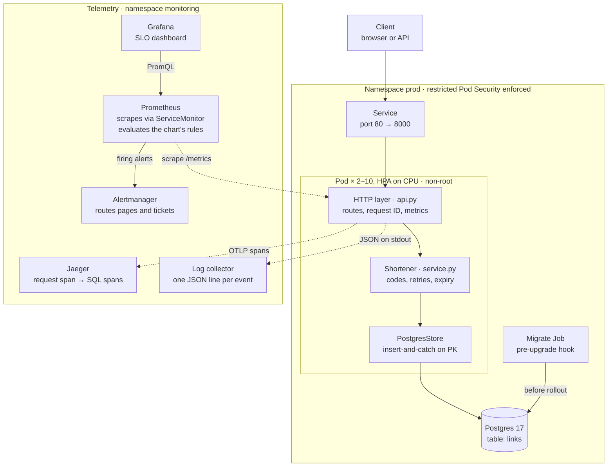

# shortly — Design Document

> Last updated 2026-10-21 for chart 0.3.0 (app changes since v0.1.0 are unreleased). Mirrored at
> [Claude Docs](https://claude.ai/artifact/1du93suG9M2oJJUvvQzYmS). Update both in the
> same PR as the change they describe (see `CLAUDE.md`).

## Overview

shortly is a URL shortener: `POST /links` returns a 7-character code, and `GET /{code}` redirects to the target with a 307. It is built as a production-shaped reference service, so the operational machinery around it (CI, supply chain, observability, deploys, rollback) matters as much as the feature.

**Status:** v0.1.0 released 2026-10-20 as `ghcr.io/statsguy/shortly@sha256:ef71dd3e544d…` (amd64 + arm64), with signed SLSA provenance. It deploys to local Kubernetes (kind) in `staging` and `prod` namespaces.

**Goals**

- Correct, unguessable short links with optional expiry.
- Every change gated by CI: lint, strict types, tests against real Postgres, image scan, container smoke test, Kubernetes deploy and rollback drill.
- Verifiable artifacts: an image is identified by digest and traceable to a commit, tag and workflow.
- Zero-downtime rollouts with automatic rollback, rehearsed on every PR.
- Logs, metrics and traces that link to each other.

**Non-goals (for now)**

- Custom aliases, link editing or deletion, user accounts, analytics dashboards.
- Multi-region or a managed cloud deployment (the chart is portable; the infrastructure is not built yet).
- Abuse prevention (rate limiting, malicious-URL screening).

**Scope of this doc:** the system as of chart 0.3.0: v0.1.0 plus the unreleased capacity work (autocommit, load shedding, HPA), and SLOs with burn-rate alerts delivered through kube-prometheus-stack. Operational procedures live in [RUNBOOK.md](RUNBOOK.md).

## Architecture

A request enters through the Kubernetes Service, crosses three in-process layers, and ends in one Postgres primary-key operation; logs, metrics and traces leave the pod on separate paths.



The layers depend inward only: `api.py` knows the `Shortener`, which knows the `LinkStore` Protocol, never Postgres. `PostgresStore` and `InMemoryStore` are interchangeable adapters that pass the same contract test suite. The migration Job runs from the same image before new pods start.

## Domain model and code generation

A `ShortLink` is a frozen Pydantic model, validated once at creation so the rest of the code can trust it.

| Field | Type | Invariant |
| --- | --- | --- |
| `code` | str | base62, 7 characters by default |
| `target` | `HttpUrl` | http or https only (`javascript:`, `ftp:` rejected) |
| `created_at` | aware datetime | naive datetimes rejected |
| `expires_at` | aware datetime or null | must be later than `created_at`; a link is expired at and after this instant |

**Codes** come from `secrets.choice` over `[0-9a-zA-Z]`. A code is a capability: whoever holds it can resolve the URL, so it must be unpredictable. `random` is a predictable PRNG and is banned by ruff rule S311.

**Collisions.** With N = 62⁷ ≈ 3.52 × 10¹² codes, the birthday bound gives P(collision among n) ≈ 1 − e^(−n²/2N):

| Links stored | P(at least one collision) |
| --- | --- |
| 10,000 | about 1.4 × 10⁻⁵ |
| 266,000 | about 1% |
| 2,200,000 | about 50% |

Collisions are therefore expected long before the space is full, and they are handled rather than prevented.

**Insert-and-catch, not check-then-insert.** `Shortener.shorten` draws a code and calls `store.add`; the store raises `CodeConflictError` atomically (the Postgres primary key), and the service retries with a fresh code up to 5 times, then raises `CodeSpaceExhaustedError` (HTTP 503). A `get` before `add` would race under concurrency. Only unique violations are retried; any other integrity error propagates as a bug.

**Injected nondeterminism.** The code generator and the clock are constructor arguments. Tests pass `scripted_codes("dup", "dup", "fresh")` and a `FakeClock` instead of patching globals. An `on_collision` hook feeds the `code_collisions_total` metric without the domain layer importing Prometheus.

## HTTP API

The HTTP layer only parses input, calls the service and maps outcomes to status codes; it holds no business logic. It is built by `create_app(shortener, base_url=..., metrics=..., tracer_provider=...)`, so tests construct it with in-memory dependencies.

| Method + path | Success | Errors | Notes |
| --- | --- | --- | --- |
| `POST /links` | 201 `{code, short_url, target, expires_at}` | 422 invalid URL or TTL; 503 code space exhausted | Body `{"url": "https://…", "ttl_seconds": 1..31536000}` (TTL optional) |
| `GET /{code}` | 307, `Location: <target>` | 404 unknown; 410 expired; 503 + `Retry-After: 1` when the DB pool is exhausted | Sync endpoint: blocking DB calls run in the threadpool |
| `GET /healthz` | 200 | — | Liveness: process is responsive. Never touches the DB. `async`: answered on the event loop, never behind request work |
| `GET /readyz` | 200 | 503 when the DB ping fails | Readiness: can this pod take traffic. The ping runs on its own one-thread limiter, not the request threadpool |
| `GET /metrics` | 200, Prometheus text | — | Should be reachable only from inside the cluster. `async`, so scrapes don't time out under load |

Any endpoint that touches the database returns **503 with `Retry-After: 1`** when no pooled connection frees up within `SHORTLY_DB_POOL_TIMEOUT_SECONDS`. The store raises `StoreBusyError` (overload, not failure), and the API maps it in one place and counts it in `load_shed_total`.

**307, not 301.** Browsers cache a 301 indefinitely, so an expired link would keep redirecting and future click analytics would never see repeat visits.

**Liveness vs readiness.** A database outage flips `/readyz` to 503, which removes pods from Service endpoints, while `/healthz` stays 200, so Kubernetes does not restart them. Restarting every pod during a DB outage would add a restart storm to the outage. Verified: with Postgres stopped, readiness returns 503 and liveness 200; both recover without an app restart.

**`short_url`** is built from the configured `base_url`, never from the request `Host` header, which a client controls.

Every response carries `x-request-id`. A caller-supplied ID matching `[A-Za-z0-9._-]{1,64}` is propagated; anything else is replaced with a new UUID, which prevents log injection.

## Data and migrations

One table, defined with SQLAlchemy Core in `src/shortly/db.py`; the database enforces the same invariants as the model.

```sql
CREATE TABLE links (
  code        VARCHAR(32) PRIMARY KEY,          -- uniqueness = atomic collision detection
  target      TEXT NOT NULL,
  created_at  TIMESTAMPTZ NOT NULL,
  expires_at  TIMESTAMPTZ NULL,
  CONSTRAINT expiry_after_creation CHECK (expires_at IS NULL OR expires_at > created_at)
);
```

**Access path.** Writes are single-row inserts; reads are primary-key lookups. No secondary indexes are needed yet. `PostgresStore` maps only `psycopg.errors.UniqueViolation` to `CodeConflictError`.

**Connection pool.** SQLAlchemy `QueuePool` with a **fixed** size: `pool_size` from `SHORTLY_DB_POOL_SIZE` (default 5) and `max_overflow=0`, so each pod's connection count is a known number for the Postgres budget (see Capacity). `pool_timeout` comes from `SHORTLY_DB_POOL_TIMEOUT_SECONDS` (default 1 s, instead of SQLAlchemy's 30 s): a request waits at most that long for a connection and then gets a 503. `pool_pre_ping=True` means a DB restart costs a reconnect rather than one failed request per stale connection; it costs one round trip per checkout and is kept on purpose. One-shot processes (migrations) use `NullPool`.

**Autocommit.** The app's engine runs with `isolation_level="AUTOCOMMIT"`. Every query the app issues is a single statement, which Postgres already executes atomically, so the implicit `BEGIN … COMMIT/ROLLBACK` added two round trips per request for no safety gain. Removing them raised one pod's capacity by about 25% (see Capacity). An integration test checks the behaviour (a write is visible to another connection without `commit()`). A future multi-statement unit of work must opt back in explicitly with `conn.execution_options(isolation_level="READ COMMITTED")`. Migrations use their own engine and stay transactional.

**Migrations** are Alembic revisions in `migrations/versions/`. The database URL comes from the same `Settings` as the app. New revisions are formatted by ruff via a post-write hook.

Guards in the test suite:

- `alembic check` fails if `db.py` and the migrations drift apart.
- Every run downgrades to base and re-applies head.
- Integration tests run against a real `postgres:17-alpine` container (testcontainers), migrated with the real migrations.

**How migrations run in production.** A Helm `pre-install,pre-upgrade` hook Job runs `alembic upgrade head` from the release's own image before any new pod starts. A failed migration aborts the release while the old pods keep serving. It is one Job per release, never an initContainer per replica, which would race on the schema.

**Compatibility rule: expand, deploy, contract.** During a rollout, old pods serve against the new schema, and a rollback runs old code against it too. Every migration must therefore be backward compatible with the previous app version. Destructive changes (drop or rename a column) ship in a later release, after no running version reads the old shape.

## Configuration and secrets

All configuration comes from environment variables, parsed by `pydantic-settings` at startup. An invalid or missing value stops the process on boot rather than failing on the first request; the rollback drill relies on this.

| Variable | Default | Meaning |
| --- | --- | --- |
| `SHORTLY_DATABASE_URL` | required | Postgres DSN; always from a Kubernetes Secret |
| `SHORTLY_BASE_URL` | `http://localhost:8000` | Public base for `short_url` |
| `SHORTLY_DB_POOL_SIZE` | `5` | Connections per pod (fixed, no overflow) |
| `SHORTLY_DB_POOL_TIMEOUT_SECONDS` | `1.0` | Longest wait for a pooled connection before a 503 |
| `SHORTLY_LOG_LEVEL` | `INFO` | One of DEBUG, INFO, WARNING, ERROR |
| `SHORTLY_LOG_JSON` | `true` | `false` for human-readable local logs |
| `SHORTLY_SERVICE_NAME` | `shortly` | `service.name` on traces |
| `OTEL_EXPORTER_OTLP_ENDPOINT` | unset | Tracing is on only when set; other `OTEL_*` vars are honoured |

**Secrets** never appear in values files or the repo. The chart reads the DB URL from `database.existingSecret` (default `shortly-db`, key `url`). Locally, `scripts/cluster.sh` generates a random 32-character password per namespace; in a real cluster the Secret would come from a secret manager (External Secrets, Vault, Sealed Secrets). `.env` is git-ignored; `.env.example` is the committed template. The Docker build context is an allow-list (`.dockerignore`), so `.env` cannot reach an image layer.

## Observability

The three signals point at each other: a log line carries the request ID and trace ID, a trace contains the SQL that ran, and metrics are labelled by the same route template the logs and traces use.

**Logs.** One JSON object per line on stdout (the platform collects it; the root filesystem is read-only). uvicorn and SQLAlchemy logs are routed through the same formatter. An access line is written per request by a pure-ASGI middleware:

```json
{"ts": "2026-10-21T04:30:16.343+00:00", "level": "info", "logger": "shortly.access", "msg": "request", "request_id": "d0853a21…", "trace_id": "bb2a4793…", "span_id": "588f9536…", "method": "GET", "route": "/{code}", "status": 404, "duration_ms": 2.51}
```

Probe and scrape requests (`/healthz`, `/readyz`, `/metrics`) log at DEBUG so they don't drown real traffic.

**Metrics** (Prometheus, per-app registry):

| Metric | Type | Labels | Answers |
| --- | --- | --- | --- |
| `http_requests_total` | counter | method, route, status | Traffic and error rate |
| `http_request_duration_seconds` | histogram | method, route | Latency; buckets 5 ms to 2.5 s around a 50 ms redirect target |
| `links_created_total` | counter | — | Write volume |
| `link_resolutions_total` | counter | outcome = hit, not_found, expired | Redirect outcomes |
| `code_collisions_total` | counter | — | A rising rate means codes need to get longer |
| `db_pool_size` | gauge | — | Configured connections per pod |
| `db_pool_in_use` | gauge | — | Connections checked out now; near `db_pool_size` means the pool is the bottleneck |
| `load_shed_total` | counter | — | Requests rejected with 503 because the backend was saturated |

**Cardinality rule.** The `route` label is the route template (`/{code}`), never the raw path. Raw paths would create one time series per link ever made. A test asserts that 50 distinct codes produce one series; unmatched paths share `route="unmatched"`.

**Traces** (OpenTelemetry, OTLP/HTTP) are enabled only when `OTEL_EXPORTER_OTLP_ENDPOINT` is set. FastAPI instrumentation creates the server span (probes excluded; per-ASGI-message send/receive spans excluded, which cut span volume about 3×). Database spans come from **psycopg driver** instrumentation. The SQLAlchemy instrumentation was tried first and silently did nothing: it supports SQLAlchemy < 2.1 and we run 2.1.4. An integration test now fails if SQL spans stop appearing in the request's trace. Buffered spans are flushed on shutdown.

## SLOs and alerting

Four SLOs say what users can expect from shortly. Alerts fire when the error budget is being spent too fast, not whenever a metric looks unusual.

| SLO | SLI (good events ÷ valid events) | Objective, 30 days | Budget |
| --- | --- | --- | --- |
| `redirect-availability` | `GET /{code}` responses that are not 5xx | 99.9% | 0.1%: about 43 minutes of full outage |
| `redirect-latency` | `GET /{code}` responses faster than 50 ms | 99% | 1% |
| `create-availability` | `POST /links` responses that are not 5xx | 99.5% | 0.5% |
| `create-latency` | `POST /links` responses faster than 100 ms | 99% | 1% |

**What counts as good.** 404 (unknown link) and 410 (expired) are correct answers, so they are good events. Every 5xx is bad, including the 503 from load shedding: the user did not get an answer. The redirect latency target is the load test's gate (p99 < 50 ms). Redirects get the stricter objectives because every click depends on them, while a failed create can be retried by its caller.

**Source of truth.** The SLOs are declared in `deploy/prometheus/slos.yaml`. `scripts/gen_slo_rules.py` turns that file into Prometheus rules in `deploy/helm/shortly/rules/slo.yaml`, which is committed so reviewers see the real PromQL. The rules live in the chart because the chart ships them (see Delivery below). For each SLO the generator emits:

- `slo:sli_error:ratio_rate<window>`: the error ratio over 5m, 30m, 1h, 2h, 6h, 1d, 3d and 30d.
- `slo:objective:ratio`: the target itself.
- `slo:error_budget_remaining:ratio`: the share of the 30-day budget left. A negative value means the budget is overspent.
- Two burn-rate alerts, one paging and one ticketing.

All series are per `namespace`, so staging and prod keep separate budgets.

**Burn-rate alerts** (multi-window, multi-burn-rate, from the Google SRE Workbook). The burn rate is how fast the budget is being spent; at 1x it lasts exactly 30 days. An alert fires only when a long window shows the burn is significant **and** a short window shows it is still happening. That makes it fire within minutes of a real incident, and clear once the short windows are clean again: after 5 minutes for the 14.4x pair, 30 minutes for the 6x pair.

| Severity | Fires when (either pair) | Budget spent by then | `for` |
| --- | --- | --- | --- |
| page | 14.4x over 1h and 5m, or 6x over 6h and 30m | 2% or 5% | 2m |
| ticket | 3x over 1d and 2h, or 1x over 3d and 6h | 10% | 15m |

**Cause-based alerts** in `deploy/helm/shortly/rules/shortly.yaml` (hand-written) cover what an SLO computed from the app's own metrics cannot see, or warn before the budget is spent:

| Alert | Severity | Why the SLO alerts miss it |
| --- | --- | --- |
| `ShortlyDown` | page | No pod scraped means no traffic data; every ratio is empty and no burn-rate alert can fire |
| `ShortlyNoAvailablePods` | page | One environment with zero pods produces no metrics of its own, while another environment keeps `up` non-empty; this uses kube-state-metrics |
| `ShortlyNotReady` | page | Pods out of rotation fail requests at the load balancer, which the app never counts |
| `ShortlyLoadShedding` | ticket | It burns the budget too, but this alert names the cause: the DB pool is exhausted |
| `ShortlyAtMaxReplicas` | ticket | The HPA has no headroom left; uses kube-state-metrics |

**How the rules are kept honest** (`tests/test_alert_rules.py`, which runs in CI):

1. The committed `slo.yaml` must equal what the generator produces from `slos.yaml`.
2. promtool unit tests (`deploy/prometheus/tests/alerts_test.yaml`) feed in synthetic series. They check that each alert fires when it should and stays quiet when it shouldn't: within budget, 404s, one pod down, too early for `for`, and staging versus prod.
3. Every selector in every rule must match a sample the app actually exports, after the test has driven every outcome through the app (201, 307, 404, shed 503, readiness 503, exhausted code space). So a renamed route, metric, label or histogram bucket fails the build instead of silently disabling an alert.
4. Every `runbook_url` must point at a heading that exists in RUNBOOK.md.
5. Every query on the SLO dashboard must select something the app exports or a recorded series.
6. amtool validates the Alertmanager config and checks where each kind of alert is routed.

**Delivery in Kubernetes.** `scripts/cluster.sh` installs kube-prometheus-stack 91.9.0 (pinned by version and digest) into a `monitoring` namespace: Prometheus Operator, Prometheus, Alertmanager, kube-state-metrics and Grafana. Pieces that can't work in kind are disabled: control-plane scraping, and node-exporter, which needs host namespaces that the namespace's `baseline` Pod Security level forbids. The shortly chart then ships its own monitoring:

| Object | Rendered in | Why |
| --- | --- | --- |
| ServiceMonitor | every release with `monitoring.enabled` | Prometheus scrapes each pod's `/metrics` through the Service; `job="shortly"`, plus the pod's `namespace` |
| PrometheusRule, one per file in `rules/` | prod only (`monitoring.clusterWide`) | The rules aggregate `by (namespace)` and so already cover every environment. A second copy would evaluate every recording rule twice and collide |
| Dashboard ConfigMap (`dashboards/slo.json`) | prod only | Grafana's sidecar loads it from any namespace; an environment drop-down picks staging or prod |

The CRD-backed objects are rendered only where the Prometheus Operator CRDs exist (`.Capabilities.APIVersions`), so the chart still installs on a cluster without them.

Alertmanager routing (`deploy/kind/monitoring-values.yaml`):

| Alert | Receiver |
| --- | --- |
| anything in `staging` | `staging`: staging never pages anyone |
| `severity="page"` | `pager` |
| `severity="ticket"` | `tickets` |
| the stack's own alerts and its `Watchdog` heartbeat | `null` |

Two inhibitions cut the noise. A page silences the ticket for the same alert, SLO and namespace. `ShortlyNoAvailablePods` silences the burn-rate, readiness and shedding alerts in its namespace, because they are symptoms of the same cause. The receivers are placeholders with no integration, so nothing leaves the cluster; in a real setup `pager` gets PagerDuty and `tickets` gets Slack, with credentials in a Secret.

**Proven on every PR.** `scripts/monitoring-check.sh`, the last step of the kind e2e, checks the whole path in the cluster:

- Prometheus scrapes the prod pods through the ServiceMonitor.
- All five rule groups load, and every rule reports `health=ok`.
- The SLO recording rules produce series for prod.
- Every dashboard query is valid PromQL.
- A real alert completes the path. The script scales staging to zero; `ShortlyNoAvailablePods` fires and reaches Alertmanager, which routes it to the `staging` receiver. Then staging is restored.

On the first CI run (PR #14), Prometheus scraped all 4 prod pods (the HPA drill had just scaled them up) and all 12 dashboard queries parsed. The staging alert reached Alertmanager **81 s** after the scale-down: about 15 s for kube-state-metrics to be scraped, 60 s of `for`, then evaluation.

**Live drill.** Prometheus in the compose `obs` profile loads the same rule files; firing alerts show at `http://localhost:9090/alerts` (the compose stack has no Alertmanager). The drill ran k6 at 100 req/s and paused Postgres for 6 minutes. What happened, with times measured from the pause:

| Time after pause | What happened |
| --- | --- |
| +30 s | The 5-minute error ratio started climbing (3%). Every burn-rate alert went to `pending` |
| +2.5 min | `RedirectAvailabilityBudgetBurn` (page) **fired**, along with the create and latency SLO pages. Shed requests take the full 1 s pool timeout, so they burn the latency budget too |
| +5.5 min | `ShortlyLoadShedding` (ticket) fired: its `for: 5m` had elapsed |
| Resume +5.5 min | The 5-minute error ratio was back to 0, and `ShortlyLoadShedding` resolved |
| Resume +7.5 min (end of drill) | The pages were **still firing**, which is correct. The 6x pair's short window is 30 minutes, so a page clears about 30 minutes after recovery, not 5 |

The drill also corrected the runbook. It had said a page clears within about 5 minutes; the real figure is about 30. `ShortlyNotReady` didn't fire because nothing probes `/readyz` in compose, while kubelet does in Kubernetes. The ticket alerts stayed `pending`: their `for: 15m` hadn't elapsed by the end of the drill.

## Build, CI and supply chain

No change reaches `main` without passing three CI jobs, and no image is published without passing a vulnerability scan first.

**Toolchain.** Python 3.14 (`.python-version`), uv with a committed `uv.lock`, `src/` layout. ruff (lint + format, including security rules S, naive-datetime DTZ and blocking-in-async ASYNC), mypy `--strict`, pytest with branch coverage. The same checks run in pre-commit locally and in CI.

| Gate | When | What it proves |
| --- | --- | --- |
| `lint, type-check, test` | every PR, push to main | `uv sync --locked`, format, lint, mypy, ~100 tests incl. real Postgres, promtool and amtool; coverage floor 90% (currently ~98%) |
| `build, scan, smoke-test image` | every PR, push to main | Image builds; Trivy finds no fixable HIGH/CRITICAL; black-box smoke test (non-root, readiness, create → 307, request IDs, metrics, JSON logs, SIGTERM → exit 0) |
| `deploy to kind, rollback drill` | every PR, push to main | Digest-mode render passes API-server dry run; staging deploy under restricted PSS; same image promoted to prod; broken release auto-rolls back with 0 failed requests; manual `helm rollback` works; under in-cluster k6 load the HPA adds ready pods; monitoring end to end, from scrape to an alert routed by Alertmanager |
| Release workflow | tag `vX.Y.Z` | Tag equals `pyproject.toml` version; scan before publish; multi-arch push; SBOM; signed provenance; GitHub Release with digest |

**Image.** Multi-stage: uv builds the virtualenv in a builder stage, and only the venv reaches the runtime stage. Dependencies are a separate cached layer from the code. Runtime runs as UID 10001 with code owned by root (read-only to the app), pip removed (its vendored urllib3/msgpack/setuptools were the only HIGH findings), exec-form `CMD` so uvicorn is PID 1 and receives SIGTERM.

**Pinning.** Base images and the uv image are pinned by digest; GitHub Actions are pinned by commit SHA; Python dependencies by `uv.lock` with hashes. Workflows declare least-privilege `permissions`, and checkout uses `persist-credentials: false`.

**Provenance.** BuildKit attaches an SBOM and `mode=max` provenance to each pushed image. `actions/attest-build-provenance` signs a SLSA v1 statement keylessly through Sigstore, using the workflow's OIDC identity, and records it in the public transparency log. Verify with:

```bash
gh attestation verify oci://ghcr.io/statsguy/shortly@<digest> --owner statsguy \
  --signer-workflow statsguy/shortly/.github/workflows/release.yml --source-ref refs/tags/<tag>
```

**Keeping pins fresh.** Dependabot opens weekly PRs for uv dependencies (grouped), action SHAs and base-image digests; CI decides whether they are safe. `tests/test_toolchain.py` fails if the Dockerfile's Python differs from `.python-version`, so an interpreter bump must be a deliberate change to both.

## Deployment

One Helm chart (`deploy/helm/shortly`, Helm 4) deploys the same image digest to `staging`, then `prod`; per-environment differences live only in `deploy/envs/<env>.yaml`.

| | staging | prod |
| --- | --- | --- |
| Replicas | 1, fixed | HPA, 2–4 on CPU (chart default 2–10) |
| Monitoring | ServiceMonitor | ServiceMonitor, PrometheusRules, SLO dashboard (`clusterWide`) |
| PodDisruptionBudget | none (would block drains) | `minAvailable: 1` |
| Log level | DEBUG | INFO |
| Requests / memory limit | 25m CPU, 96Mi / 192Mi | 500m CPU, 128Mi / 256Mi |

**Build once, deploy many.** `scripts/deploy.sh <env> <image-ref>` takes a digest reference (`repo@sha256:…`) for released images; the bits tested in staging are the bits promoted to prod. A tag reference is accepted for local images and is loaded into kind first. The chart refuses to render with neither digest nor tag.

**Rollout.** `helm upgrade --install --rollback-on-failure --wait --timeout 3m`. `RollingUpdate` with `maxUnavailable: 0, maxSurge: 1` never drops below desired capacity: a new pod that never becomes ready stalls the rollout while old pods keep serving, Helm times out and rolls back. The drill measures this: 0 failed requests through the Service during a broken rollout.

**Probes.** startupProbe on `/healthz` (2 s × 30) gates the others; liveness `/healthz` every 10 s, 3 failures; readiness `/readyz` every 5 s, 2 failures; both with a 2 s timeout.

The probes, and `/metrics`, never wait in the request threadpool. FastAPI runs sync handlers on 40 shared threads, so under overload a sync `/healthz` queued behind user requests. Its probe timed out, kubelet restarted the pod, the remaining pods took more load, and they were restarted too. The outage fed itself. The CI autoscaling drill hit exactly this once the monitoring stack shared the node: pods fell to 0 ready during the load. `/healthz` and `/metrics` are now `async`, and `/readyz` pings the database on a dedicated one-thread limiter. A test saturates the threadpool and requires all three to answer in under 0.5 s; with the old handlers they took about 0.8 s.

**Graceful shutdown.** On termination Kubernetes removes the pod from endpoints and sends SIGTERM concurrently. A `preStop` sleep of 5 s lets routers stop sending traffic first; uvicorn then drains in-flight requests for up to 20 s; `terminationGracePeriodSeconds: 30` covers both.

**Pod hardening.** Pod and Job run as UID/GID 10001, `runAsNonRoot`, `readOnlyRootFilesystem` (a 16 Mi `emptyDir` at `/tmp`), all capabilities dropped, no privilege escalation, `seccompProfile: RuntimeDefault`, `automountServiceAccountToken: false`. Both namespaces **enforce** the restricted Pod Security Standard, so the API server rejects a regression.

**Resources.** The CPU request (500m) is the measured usage at the per-pod design load, and it is what the HPA's percentage is computed against (see Capacity). Memory limit set (a leak OOM-kills one pod, not the node); no CPU limit (avoids CFS throttling on an idle node). Replicas spread across nodes with a topology spread constraint.

**Autoscaling.** When `autoscaling.enabled` (the default; off in staging), the chart renders a `HorizontalPodAutoscaler` and leaves `replicas` out of the Deployment, because a value there would reset the live count on every `helm upgrade`. Rendering fails if CPU requests are missing (the HPA would never scale) or if `maxReplicas × dbPoolSize` exceeds `autoscaling.maxDbConnections`. The PodDisruptionBudget is rendered when the minimum replica count (HPA floor or fixed count) is above 1. `scripts/cluster.sh` installs metrics-server (pinned version, checksum-verified manifest) so the HPA has CPU data in kind.

**Labels.** `app.kubernetes.io/version` is the tag, or the first 12 hex characters of the digest. Chart 0.1.0 put `sha256:…` in the label, which the API server rejected (`:` is illegal); kubeconform missed it because JSON schemas don't encode label syntax. The e2e now server-side dry-runs the digest-mode render.

## Reliability and failure modes

Each failure below degrades predictably and is visible in at least one signal; [RUNBOOK.md](RUNBOOK.md) has the response for each.

| Failure | System behaviour | How you see it |
| --- | --- | --- |
| Postgres unreachable | `/readyz` 503 → pods leave Service endpoints; `/healthz` stays 200, no restarts; recovers automatically via `pool_pre_ping` | `http_requests_total{route="/readyz",status="503"}`, ready replicas < desired, `database ping failed` warnings |
| Bad release (crashes, fails readiness) | Rollout stalls; old pods keep serving (`maxUnavailable: 0`); Helm rolls back after 3 min | `deploy.sh` exits non-zero; `helm history` shows a rollback revision |
| Migration fails | Pre-upgrade Job fails; release aborted before any pod changes | Failed `shortly-migrate-<rev>` Job kept for `kubectl logs` |
| Pod crash / OOM | Restarted by kubelet; prod keeps 1 of 2 serving | Restart count, `OOMKilled` reason |
| Node drain / cluster upgrade | PDB keeps at least 1 prod pod; graceful drain on SIGTERM | Eviction events |
| Code collisions rising | Transparent retries (up to 5); then 503 | `rate(code_collisions_total[1h])` |
| Code space exhausted (5 collisions in a row) | `POST /links` 503 | 503s on `route="/links"` |
| Invalid config | Process exits at boot with a validation error | CrashLoopBackOff; first log line names the field |
| Database slow or hung | Requests holding connections wait on it; all others wait at most 1 s for a connection, then get **503 + `Retry-After`** instead of queueing for 30 s | `load_shed_total` rising, `db_pool_in_use` = `db_pool_size`, 503s on all DB routes |
| Load above capacity (CPU) | Latency rises with no errors (requests queue in the threadpool); probes and scrapes still answer, so pods are neither restarted nor pulled; HPA adds pods within about a minute, up to `maxReplicas` | p99 up, HPA `desiredReplicas` rising or pinned at max |
| Every pod down, or not scraped | No metrics at all, so the SLO ratios are empty and no burn-rate alert can fire | `ShortlyDown` (from `up`, not from app metrics) |
| Tracing backend down | Spans dropped by the batch exporter; requests unaffected | Exporter warnings in logs |
| Vulnerable dependency published | CI image scan fails; release workflow refuses to publish | Red `build, scan` job |

Links have no deletion path, so the table grows without bound.

## Capacity

One pod handles about **250 requests per second within the latency SLO**. It is limited by its own CPU, not the database or the pool. Prod scales on CPU from 2 to 10 pods.

**Method.** `scripts/loadtest.sh` runs k6 (`loadtest/k6/mixed.js`) against the compose stack at increasing fixed arrival rates:

- **Open model** (`constant-arrival-rate`). The rate does not slow down when the server does, so overload shows up as latency.
- **Traffic mix:** 90% redirects, 10% creates, over 500 seeded links.
- **CPU:** the app is pinned to 1 CPU with `docker update --cpus`. CPU per request comes from the container's cgroup counters.
- **A step passes** only if redirect p99 < 50 ms, create p99 < 100 ms, errors < 1% and k6 dropped no iterations.

The measuring host had 2 cores and about 14% steal, so treat the figures as ±15% and re-measure on target hardware.

**Before and after autocommit** (one pod, 1 CPU, same host and session):

| Offered req/s | v0.1.0: redirect p99 | Autocommit: redirect p99 |
| --- | --- | --- |
| 200 | 36.5 ms PASS | 25.0 ms PASS |
| 250 | 402 ms FAIL | 19.2 ms PASS |
| 300 | 537 ms FAIL | 344 ms FAIL (35 ms PASS in a later run: this is the knee) |
| 350 | 1,563 ms FAIL | 1,489 ms FAIL |

CPU per request fell from 2.6–2.9 ms to 2.0–2.3 ms.

**Findings**

1. **The ceiling is app CPU.** A saturated pod uses about 0.9 core and no more: one uvicorn worker means one GIL. At 250 req/s Postgres used 0.09 cores (about 0.4 ms per request), so one Postgres core can serve roughly 10 pods.
2. **Round trips were the waste.** py-spy showed each redirect making 4 DB round trips: pre-ping, implicit `BEGIN`, the `SELECT`, and `ROLLBACK`. Autocommit removes two of them.
3. **The pool is not the bottleneck.** At about 300 req/s, a median of 1 connection was in use, with a peak of 4. A pool of 1 tripled p95 latency, so the pool stays at 5.
4. **Overload queued silently.** Past the knee, latency reached seconds with zero errors. With the old 30 s `pool_timeout`, a slow database would have done the same. Now it sheds after 1 s.

**Sizing** (chart 0.2.0, `deploy/helm/shortly/values.yaml`):

| Setting | Value | Derivation |
| --- | --- | --- |
| CPU request | 500m | Measured usage at 250 req/s |
| HPA target | 70% of the request ≈ 350m ≈ 170 req/s per pod | About 30% headroom below the knee for traffic that grows while a pod is added. Adding one takes 30–60 s: 15 s metric resolution, 15 s HPA sync, then start-up and readiness. |
| minReplicas | 2 | For availability, not load: survives a pod loss or a drain, and the PDB keeps 1 up |
| maxReplicas | 10 (4 in the kind prod env) | 10 × 170 ≈ 1,700 req/s at target and about 2,500 at the knee, which is also roughly one Postgres core |
| DB connections | 10 × 5 = 50 ≤ `maxDbConnections` 60 | Postgres defaults to `max_connections` 100. The margin covers migrations, psql sessions and headroom. |
| Scale-up | Immediate; at most double, or +4 pods, every 15 s | Spikes are the risk |
| Scale-down | 1 pod per minute, after 5 stable minutes | Avoids flapping |

**Rule of thumb:** replicas needed = ⌈peak req/s ÷ 170⌉. Re-run the load test after a change to the request path (a new query, middleware, or a FastAPI, SQLAlchemy or psycopg upgrade) and on new hardware, then adjust the CPU request and target together.

**Overload behaviour.**

- **Database slow or hung.** Verified by pausing Postgres under load. The requests already holding the pool's 5 connections hung until it resumed. Every other request got a 503 in 1.0 s, and the service recovered by itself on resume.
- **CPU saturated.** These requests are not shed: they queue in the threadpool. The HPA is the defence. A concurrency limit that returns 503 is future work.
- **CI coverage.** `scripts/hpa-drill.sh` runs in CI and proves the HPA adds pods under load. It does not measure capacity.

**Autoscaling, first CI run (PR #11).** 600 req/s from inside the cluster against 2 pods:

- CPU reached 72% of the request. A third pod was ready after 51 s, and CPU then settled at 53%.
- Latency stayed low: p99 7.5 ms, and 0 of 90,101 requests failed.
- That works out to about 1.2 ms of CPU per request on the GitHub runner, against 2.0 ms on the measuring host. The same pod costs different amounts on different hardware, which is why the sizing must be re-measured on the hardware prod actually runs on.

## Security

The controls concentrate on the supply chain and the runtime blast radius; abuse prevention is the main open gap.

| Threat | Control |
| --- | --- |
| Guessing or enumerating codes | CSPRNG codes from a 3.5 × 10¹² space; no listing endpoint |
| Script injection via redirect target | Targets restricted to http/https (`javascript:` rejected) |
| Open redirect / phishing via shortly | **Not mitigated** — no URL reputation check or rate limit (see Known limitations) |
| Log injection / log flooding via headers | `x-request-id` accepted only if `[A-Za-z0-9._-]{1,64}`; JSON encoding escapes everything else |
| Host-header spoofing in generated links | `short_url` built from configured `base_url` only |
| Compromised dependency or base image | Lockfile with hashes, digest-pinned bases, Trivy gate on every PR and before publish, weekly Dependabot |
| Tampered or substituted image | Deploy by digest; signed SLSA provenance verifiable against repo, tag and workflow |
| Compromised CI action | Actions pinned by SHA; workflow `permissions` least-privilege; `persist-credentials: false` |
| Container escape / lateral movement | Non-root, read-only root FS, no capabilities, seccomp, no SA token, restricted PSS enforced |
| App rewriting its own code | Code and venv owned by root, read-only to UID 10001 |
| Secret leakage | DB URL only via Secret; `.env` git-ignored and excluded from the build context |
| Metrics exposure | `/metrics` unauthenticated; must stay cluster-internal (separate port or NetworkPolicy — not yet enforced) |

## Key decisions

| Decision | Chosen | Alternatives rejected | Why |
| --- | --- | --- | --- |
| Code generation | Random base62 + retry on conflict | Sequential IDs (hashids), hash of URL | Unguessable; no coordination between replicas; same URL can get different codes |
| Collision handling | Insert-and-catch on PK | Check-then-insert | Atomic; no race under concurrency |
| Storage access | SQLAlchemy Core, sync, psycopg 3 | ORM; async driver | One table; sync in threadpool is simple. The load test shows a CPU ceiling, which an async driver would not raise |
| Transactions | Autocommit for the app; transactions for migrations | Implicit transaction per request | Every app query is one atomic statement; saves 2 round trips per request (about +25% capacity) |
| Pool | Fixed size 5, no overflow, 1 s timeout → 503 | SQLAlchemy defaults (overflow 10, 30 s wait) | Known Postgres connection budget; overload fails fast instead of piling up |
| Scaling | HPA on CPU, 2–10 pods | Fixed replicas; scaling on request rate or latency | CPU is the measured bottleneck and needs no custom-metrics adapter |
| Storage abstraction | `LinkStore` Protocol + contract tests | Direct DB calls in service | Postgres and in-memory pass the same suite; fast unit tests |
| Redirect status | 307 | 301, 302 | Not cached permanently; preserves method |
| Probes | Separate liveness and readiness | One `/health` checking the DB | DB outage must not trigger restarts |
| Migrations | Helm pre-upgrade Job, expand/contract | App runs migrations on startup; initContainer | One runner per release; failure aborts before rollout |
| Config | Env vars validated at boot | Config files; lazy reads | Twelve-factor; fail fast |
| DB tracing | psycopg instrumentation | SQLAlchemy instrumentation | SQLAlchemy instrumentation no-ops on 2.1 |
| Metric labels | Route template | Raw path | Bounded cardinality |
| Image tags | Semver + digest, no `latest` | `latest` | "What is in prod?" must be answerable |
| Deploy target (now) | Local kind, staging + prod namespaces | Cloud cluster; PaaS | Free, realistic, chart portable to EKS/GKE |
| Rollback | Helm `--rollback-on-failure` + rehearsed `helm rollback` | Manual only | Tested on every PR |
| Alerting | Multi-window burn-rate alerts on SLOs, plus a few cause-based alerts | Threshold alerts on error rate or latency | Pages scale with user impact: a 1-minute blip doesn't page, a slow leak still opens a ticket |
| SLO rules | A small generator from `slos.yaml`, output committed | Hand-written rules; Sloth or Pyrra | 4 SLOs × 8 windows is too repetitive to write by hand. The generator is about 170 lines that are easy to review, and needs no extra binary or CRD |
| Who ships the rules | The app chart, from its prod release only | Every release, scoped with the operator's `enforcedNamespaceLabel`; a separate monitoring repo | Rules change with the code they describe and are reviewed in the same PR. One cluster-wide copy avoids duplicate series without the operator's multi-tenancy machinery |
| Monitoring stack | kube-prometheus-stack | Hand-rolled Prometheus manifests; a hosted service | The standard way to run the Prometheus Operator; CRDs make scrape config and rules part of each app's chart |

**Issues found while building**, each now covered by a test:

| Found | Issue | Guard added |
| --- | --- | --- |
| Milestone 3 | Coverage floor failed partial local runs | Floor enforced only in CI (`--cov-fail-under=90`) |
| Milestone 4 | pip in base image carried 4 HIGH CVEs | pip removed from runtime image |
| Post-#5 | Dependabot moved image to Python 3.14; tests stayed on 3.13 | `tests/test_toolchain.py` |
| Milestone 5 | SQLAlchemy instrumentation silently produced no spans | Integration test asserts SQL spans in the request trace |
| Milestone 5 | certifi CRITICAL arrived transitively via `requests` | Image scan gate (caught it) |
| Milestone 6 | Port-forward pinned one pod; drill measured the wrong thing | Drill checks through the Service from inside the cluster |
| v0.1.0 deploy | `sha256:` in a label rejected by the API server | Server-side dry run of digest-mode render |
| Milestone 7 | Implicit transactions doubled DB round trips per request | Autocommit engine; integration test of the behaviour |
| Milestone 7 | 30 s pool wait would turn a slow DB into a silent pile-up | 1 s `pool_timeout` → 503; test asserts it fails fast |
| Milestone 8 | First draft of the availability SLI, `1 − good/total`, returned *nothing* for a namespace with 100% errors (it has no "good" series), so a total outage could not alert | `bad/total`, with `or 0 × total` for no errors; promtool test "budgets are per namespace" |
| Milestone 8 | The HPA drill flaked: 600 req/s produced 75% CPU against a 70% target, and the HPA does nothing within 10% of its target | Drill load raised to 1000 req/s; on failure the drill reports whether the load was too light or the HPA failed to act |
| Milestone 8 | The selector check let `le="0.04"` pass because `route="/{code}"` contains braces | Quote-aware selector parser; the test fails on any matcher it can't parse |
| Milestone 9 | Under overload, sync `/healthz` queued behind requests; liveness failed, kubelet restarted the pods, and the restarts cascaded (CI HPA drill, with monitoring on the node) | Probes and `/metrics` off the request threadpool; probe timeout 2 s; threadpool-saturation regression test |

## Known limitations and future work

**Limitations**

- No rate limiting or URL reputation checks: shortly can be used to mask phishing links.
- No link deletion or expiry cleanup; expired rows stay in the table.
- `/metrics` is on the public port; no NetworkPolicy restricts it.
- Provenance is verified by hand; nothing stops `deploy.sh` or the cluster from running an unverified image.
- CPU overload is not shed: past capacity, requests queue until the HPA catches up or `maxReplicas` is reached.
- A request holding a connection to a hung (not dead) database has no client-side timeout.
- Capacity was measured on a small, in-memory dataset; Postgres cost per request will rise with table size.
- Alert receivers are placeholders: alerts are routed but not delivered to a person (no PagerDuty or Slack integration).
- Prometheus keeps 2 days of data in kind and has no persistent volume, so 30-day error budgets reset when its pod restarts.
- The SLIs are measured in the app. Requests that never reach it (ingress or network failures) are invisible except through `ShortlyDown` and `ShortlyNotReady`; a load-balancer SLI would be more complete.
- At very low traffic one error is a large ratio, so burn-rate alerts can be noisy; a minimum-request-rate guard is not implemented.
- Local kind only; no production cluster, backups or disaster recovery for Postgres.

**Next steps, in rough priority order**

1. Enforce provenance: `deploy.sh` runs the strict `gh attestation verify`; Kyverno or Sigstore policy-controller in-cluster.
2. Rate limiting per client on `POST /links`; Safe Browsing check on targets.
3. Move `/metrics` to a separate port; add a NetworkPolicy.
4. Expired-link cleanup job and an index on `expires_at`.
5. A concurrency limit that sheds CPU overload; a statement or socket timeout for a hung database.
6. Real cloud environment: Terraform + EKS/GKE, managed Postgres with backups, GitHub OIDC deploys, and alert receivers wired to a real pager.

**Open questions**

- Are 99.9% / 99.5% the right objectives? Revisit after 30 days of real traffic, from the measured `slo:error_budget_remaining:ratio`.
- Should repeated shortening of the same URL return the existing code (requires an index on `target`)?
