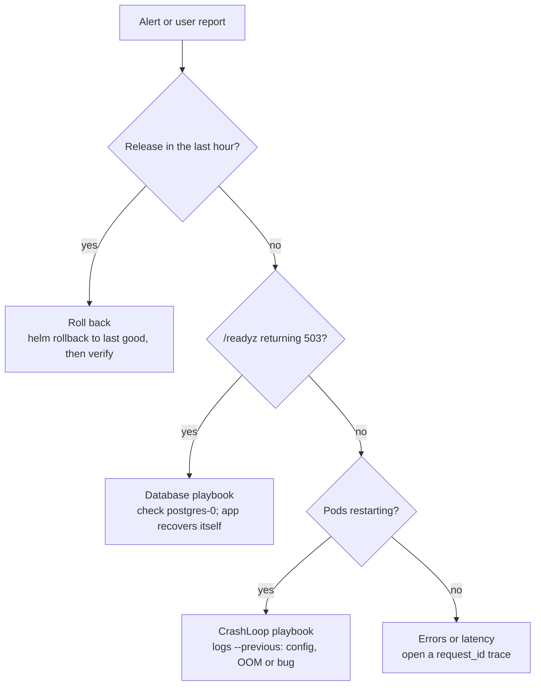

# shortly — Runbook

> Last updated 2026-10-20 for v0.1.0 / chart 0.1.1. Mirrored at
> [Claude Docs](https://claude.ai/artifact/6bjjkcg6hjcAW2HbkHnUzV). Update both in the
> same PR as the change they describe (see `CLAUDE.md`).

Operational procedures for shortly. Commands assume you are in the repo root with `kubectl` pointed at `kind-shortly`. Design rationale lives in [DESIGN.md](DESIGN.md).

## Quick reference

| Item | Value |
| --- | --- |
| Repo | [github.com/statsguy/shortly](https://github.com/statsguy/shortly) |
| Image | `ghcr.io/statsguy/shortly` — deploy by digest, never by tag |
| Current release | v0.1.0, `sha256:ef71dd3e544d6a3608d79aa063534510f4bc07c595484d8b0a15902fb30b8abb` |
| Environments | kind cluster `shortly`; namespaces `staging` (1 replica), `prod` (2 replicas) |
| Helm release | `shortly` in each namespace; chart `deploy/helm/shortly` |
| Database | `postgres` StatefulSet per namespace; URL in Secret `shortly-db` key `url` |
| Endpoints | `/healthz` liveness · `/readyz` readiness · `/metrics` Prometheus |
| Logs | JSON on stdout; `request_id` and `trace_id` on every line |

```bash
# Most-used commands
D=sha256:ef71dd3e544d6a3608d79aa063534510f4bc07c595484d8b0a15902fb30b8abb
scripts/deploy.sh staging ghcr.io/statsguy/shortly@$D     # deploy (auto-rollback on failure)
scripts/deploy.sh prod    ghcr.io/statsguy/shortly@$D
helm -n prod history shortly                               # revisions you can roll back to
helm -n prod rollback shortly <REV> --wait                 # manual rollback
kubectl -n prod get pods -l app.kubernetes.io/name=shortly # pod status
kubectl -n prod logs -l app.kubernetes.io/name=shortly --tail=100
kubectl -n prod rollout status deploy/shortly
kubectl -n prod get events --sort-by=.lastTimestamp | tail -20
kubectl -n prod port-forward svc/shortly 8080:80          # then curl localhost:8080/readyz
```

## Health checks and key queries

shortly is healthy when every desired pod is Ready, `/readyz` returns 200 through the Service, and the 5xx rate is near zero.

```bash
NS=prod
kubectl -n $NS get deploy shortly                          # READY must equal desired (2/2)
kubectl -n $NS get pods -l app.kubernetes.io/name=shortly -o wide   # restarts, node placement
kubectl -n $NS exec postgres-0 -- wget -q -O- http://shortly/readyz # through the Service, in-cluster
helm -n $NS status shortly                                # STATUS: deployed
```

Do not judge health through `kubectl port-forward svc/...`: it attaches to one pod and stops working when that pod is replaced.

**PromQL** (Prometheus at `http://localhost:9090` with the `obs` compose profile, or your cluster's Prometheus):

| Question | Query |
| --- | --- |
| Traffic and errors by route | `sum by (route, status) (rate(http_requests_total[5m]))` |
| 5xx ratio | `sum(rate(http_requests_total{status=~"5.."}[5m])) / sum(rate(http_requests_total[5m]))` |
| p99 latency by route | `histogram_quantile(0.99, sum by (le, route) (rate(http_request_duration_seconds_bucket[5m])))` |
| Redirect outcomes | `sum by (outcome) (rate(link_resolutions_total[5m]))` |
| Code space filling up | `rate(code_collisions_total[1h])` |
| Readiness failing | `rate(http_requests_total{route="/readyz",status="503"}[5m])` |

**Logs.** Filter structured fields with `jq`:

```bash
kubectl -n prod logs -l app.kubernetes.io/name=shortly --tail=500 \
  | jq -c 'select(.level=="error" or .level=="warning")'
kubectl -n prod logs -l app.kubernetes.io/name=shortly --tail=2000 \
  | jq -c 'select(.request_id=="<id from the x-request-id response header>")'
```

A `trace_id` in a log line opens the full trace in Jaeger (`http://localhost:16686`, search by trace ID) when tracing is enabled.

## Cut a release

A release is a pushed `vX.Y.Z` tag on a `main` commit whose `pyproject.toml` version matches; the workflow does the rest.

1. Open a PR that bumps `version` in `pyproject.toml` (semver: patch for fixes, minor for features, major for breaking API changes). Merge it once CI is green.
2. Tag the merge commit and push the tag:

   ```bash
   git switch main && git pull
   git tag v0.2.0 && git push origin v0.2.0
   ```
3. Watch **Actions → Release**. It fails before publishing if the tag and version differ or the image scan finds a fixable HIGH/CRITICAL vulnerability.
4. Copy the digest from the GitHub Release notes. Every deploy uses this digest.
5. Verify provenance before deploying:

   ```bash
   D=sha256:<digest from the release notes>
   gh attestation verify oci://ghcr.io/statsguy/shortly@$D \
     --owner statsguy \
     --signer-workflow statsguy/shortly/.github/workflows/release.yml \
     --source-ref refs/tags/v0.2.0
   ```

   It must exit 0. Add `--bundle-from-oci` if the GitHub API is unavailable.

**If the release workflow fails**

| Failing step | Cause | Fix |
| --- | --- | --- |
| Tag must match pyproject version | Tagged the wrong commit, or forgot the bump | `git push --delete origin vX.Y.Z && git tag -d vX.Y.Z`; fix; re-tag |
| Scan image | New fixable CVE in a dependency or base image | Bump it (`uv lock --upgrade-package <pkg>` or merge the Dependabot PR), merge, re-tag |
| Build and push | Registry or network error | Re-run the job; nothing was published |
| Attest / Create release | Permissions or API error | Re-run the job; the image is already pushed, so the digest is unchanged |

Never move or re-use a published tag; cut a new patch version instead.

## Deploy

Deploy the verified digest to staging, check it, then promote the identical digest to prod. Never rebuild for prod.

1. Set the digest and confirm the cluster context:

   ```bash
   D=sha256:<verified digest>
   kubectl config current-context        # must be kind-shortly
   ```
2. Deploy to staging:

   ```bash
   scripts/deploy.sh staging ghcr.io/statsguy/shortly@$D
   ```

   The migration Job runs first, then pods roll out. Success prints a `helm history` table whose last row is `deployed`.
3. Check staging (see Health checks):

   ```bash
   kubectl -n staging exec postgres-0 -- wget -q -O- http://shortly/readyz
   kubectl -n staging port-forward svc/shortly 8080:80 &
   curl -s -X POST localhost:8080/links -H 'content-type: application/json' -d '{"url":"https://example.com"}'
   curl -si localhost:8080/<code from the response> | head -3   # expect 307 + Location
   ```
4. Promote the same digest to prod:

   ```bash
   scripts/deploy.sh prod ghcr.io/statsguy/shortly@$D
   kubectl -n prod get deploy shortly    # READY 2/2
   ```
5. Watch for 15 minutes: 5xx ratio, p99 latency, restarts. If anything regresses, roll back (next section).

**What `deploy.sh` does:** `helm upgrade --install --rollback-on-failure --wait --timeout 3m` with the environment's values file. Override the timeout with `DEPLOY_TIMEOUT=5m`. Extra arguments go to Helm, for example `--set config.logLevel=DEBUG`.

**If the deploy fails**, Helm has already rolled back (a fresh install is uninstalled). Prod keeps serving. Find out why before retrying:

```bash
helm -n prod history shortly
kubectl -n prod get events --sort-by=.lastTimestamp | tail -30
kubectl -n prod get jobs                                      # a failed migrate Job is kept
kubectl -n prod logs job/shortly-migrate-<REV>
kubectl -n prod logs -l app.kubernetes.io/name=shortly --previous --tail=50
```

## Roll back

Roll back first, investigate second: when a release is bad, restore the last good revision, then debug from logs and the failed revision.

**Automatic.** A deploy whose pods never become ready, or whose migration Job fails, is rolled back by `--rollback-on-failure` within the timeout (3 min). Nothing to do except find the cause.

**Manual** (the release deployed fine but misbehaves):

1. Find the last good revision:

   ```bash
   helm -n prod history shortly
   ```

   Pick the newest row with status `superseded` that you trust, and note its REVISION.
2. Roll back and wait:

   ```bash
   helm -n prod rollback shortly <REV> --wait --timeout 3m
   kubectl -n prod rollout status deploy/shortly
   ```
3. Verify through the Service:

   ```bash
   kubectl -n prod exec postgres-0 -- wget -q -O- http://shortly/readyz
   kubectl -n prod get deploy shortly -o jsonpath='{.spec.template.spec.containers[0].image}{"\n"}'
   ```

   The image must be the previous digest.
4. Roll back staging too if the bad release is there, so the environments don't diverge.
5. Open an incident note (see Incident process) with the bad digest and revision.

**Schema is not rolled back.** `helm rollback` does not run the pre-upgrade migration hook and does not downgrade the database. That is safe because every migration must be backward compatible with the previous version (expand/contract).

If a migration itself broke something and the old code cannot run on the new schema, downgrade **before** rolling back. Only the new image contains the new revision, so the old one cannot undo it:

1. Back up the database (`kubectl -n prod exec postgres-0 -- pg_dump -U shortly shortly > backup.sql`).
2. Downgrade one revision from a pod still running the new image:

   ```bash
   kubectl -n prod exec deploy/shortly -- alembic downgrade -1
   kubectl -n prod exec deploy/shortly -- alembic current
   ```
3. Then `helm rollback` as above.

**Rehearsal.** `scripts/k8s-e2e.sh` performs both an automatic and a manual rollback on every PR. If those steps start failing in CI, treat it as a broken rollback path, not a flaky test.

## Ship a schema change safely

Every migration must work with both the new code and the code it replaces, because old pods serve during a rollout and a rollback runs old code on the new schema. Destructive changes therefore take three releases.

1. **Expand** (release N): add the new shape without removing the old. New columns are nullable or have a default; new tables are unused so far.

   ```bash
   # edit src/shortly/db.py, then
   uv run alembic revision --autogenerate -m "add clicks column"
   uv run alembic upgrade head --sql      # read the SQL before committing
   uv run pytest                          # alembic check + downgrade/upgrade round trip run here
   ```
2. **Migrate code** (release N or N+1): the app writes both shapes and reads the new one. Backfill existing rows in a separate, batched job if needed, never inside the migration.
3. **Contract** (release N+2): once no running version reads the old shape (check `helm -n prod history` for what can still be rolled back to), drop it.

**Rules for the migration itself**

- Locks: in Postgres, adding a nullable column is quick; adding a `NOT NULL` column with a volatile default, changing a column type, or creating an index without `CONCURRENTLY` can lock the table. Use `op.create_index(..., postgresql_concurrently=True)` inside an `autocommit_block()`.
- Keep the hook within budget: the migration Job has `activeDeadlineSeconds: 300`. Longer work goes in a backfill job.
- Renames are a drop plus an add. Do them with expand/contract, never in one step.
- Every revision needs a working `downgrade()`; CI runs it.

## Incident playbooks

Start every incident with the same two questions: did something just change (`helm -n prod history shortly`), and is the database reachable? Most incidents are a recent release or the DB.



Ask the three questions in order; the first yes picks the playbook below.

### Pods not Ready, `/readyz` returns 503

**Likely cause:** the database is unreachable. `/healthz` stays 200, so pods are not restarted; they are only removed from the Service.

```bash
kubectl -n prod logs -l app.kubernetes.io/name=shortly --tail=200 | jq -c 'select(.msg=="database ping failed")' | tail -3
kubectl -n prod get pods -l app=postgres
kubectl -n prod logs postgres-0 --tail=50
kubectl -n prod exec postgres-0 -- pg_isready -U shortly -d shortly
```

**Fix:** restore Postgres (restart `kubectl -n prod delete pod postgres-0`, check its PVC, free disk). The app recovers by itself once the DB answers; do not restart app pods. If credentials changed, check that Secret `shortly-db` matches `postgres-auth`.

### CrashLoopBackOff

```bash
kubectl -n prod describe pod <pod> | sed -n '/Last State/,/Exit Code/p'
kubectl -n prod logs <pod> --previous --tail=30
```

| What the log or state shows | Cause | Fix |
| --- | --- | --- |
| `ValidationError for Settings` naming a field | Bad or missing config | Fix the value in `deploy/envs/<env>.yaml` or the Secret; redeploy |
| `OOMKilled` | Memory above 256Mi | Raise `resources.limits.memory`; look for a leak |
| Exit code 1 right after a deploy | Bad release | Roll back (Roll back section) |

### Deploy stuck or failed

Helm rolls back automatically after 3 minutes. To see why:

```bash
kubectl -n prod get pods,jobs
kubectl -n prod get events --sort-by=.lastTimestamp | tail -30
```

| Event or state | Cause | Fix |
| --- | --- | --- |
| `ImagePullBackOff` | Wrong digest, or the GHCR package is private | Check the digest; make the package public or add `imagePullSecrets` |
| `violates PodSecurity "restricted"` | A chart change dropped a security setting | Restore the `securityContext` in the chart |
| Migrate Job `Failed` | Migration error | `kubectl -n prod logs job/shortly-migrate-<REV>`; fix the migration in a new release |
| `Pending`, `Insufficient cpu/memory` | Node is full | Lower requests or add capacity |

### 5xx rate rising

```bash
kubectl -n prod logs -l app.kubernetes.io/name=shortly --tail=1000 | jq -c 'select(.status>=500)' | tail -20
```

- 503 on `route="/links"`: code space exhausted (5 collisions in a row). Check `rate(code_collisions_total[1h])`; the fix is longer codes (`DEFAULT_LENGTH`) in a release.
- 500s with an `exc` field: an unhandled bug. Find the `request_id`, open its trace, roll back if it started with a release.

### Latency up

Check p99 by route. Open a slow request's trace in Jaeger: a long `SELECT`/`INSERT` span points at the database; a long gap before it points at pool exhaustion (raise `config.dbPoolSize` or replicas, within the DB's `max_connections`).

### Code collisions rising

Not an outage: retries absorb it. Plan a release that raises `DEFAULT_LENGTH` from 7 to 8 (62× more codes). Existing codes keep working.

### A vulnerability is announced in a dependency

Check whether the running digest is affected (the SBOM is attached to the image). Bump the package (`uv lock --upgrade-package <pkg>`) or merge the Dependabot PR, cut a patch release, deploy.

## CI failures

Every CI step can be reproduced locally with the same command; reproduce before you guess.

| Job → step | Usual cause | Reproduce and fix |
| --- | --- | --- |
| lint → `uv sync --locked` | `pyproject.toml` changed without updating `uv.lock` | `uv lock`, commit the lockfile |
| lint → format check | Unformatted code | `uv run ruff format .` (pre-commit does this on commit) |
| lint → ruff / mypy | Lint or type error | `uv run ruff check .` / `uv run mypy src tests` |
| test → `test_toolchain.py` | Dockerfile Python and `.python-version` differ (e.g. a Dependabot base-image bump) | Move both, plus `requires-python` and ruff `target-version`, in one PR |
| test → `test_models_match_migrations` | `db.py` changed without a migration | `uv run alembic revision --autogenerate -m "…"` |
| test → coverage below 90% | New code without tests | `uv run pytest --cov-fail-under=90` with Docker running |
| test → `Docker is required` | Integration tests can't reach Docker | CI only; re-run. Locally they skip instead |
| image → Scan image | New fixable HIGH/CRITICAL CVE, often transitive | Find the package in the Trivy table; `uv lock --upgrade-package <pkg>` or bump the base digest |
| image → Smoke test | The container misbehaves | `docker build -t shortly:dev . && scripts/smoke.sh`; on failure it prints container logs |
| k8s → digest-mode render | API server rejects a manifest (e.g. an invalid label) | `helm template … --set image.digest=sha256:<64 hex> \| kubectl apply --dry-run=server -f -` against kind |
| k8s → drill | Deploy, promotion or rollback broke | `scripts/cluster.sh up && docker build -t shortly:e2e . && IMAGE=shortly:e2e scripts/k8s-e2e.sh`; diagnostics print on failure |

A test that fails with warnings as errors (`filterwarnings = error`) usually means a dependency deprecated something. Fix the call site; don't silence the warning globally.

## Local cluster operations

The local environments are disposable: `scripts/cluster.sh up` rebuilds them from nothing in a few minutes.

**Prerequisites:** Docker Desktop running, plus `brew install kind kubectl helm` (Helm 4 or newer).

| Task | Command |
| --- | --- |
| Create (idempotent) | `scripts/cluster.sh up` |
| Tear down everything | `scripts/cluster.sh down` |
| Reset one environment's data (then redeploy so migrations recreate the schema) | `kubectl -n staging delete statefulset postgres && kubectl -n staging delete pvc data-postgres-0 && scripts/cluster.sh up` |
| Deploy a local build | `docker build -t shortly:dev . && scripts/deploy.sh staging shortly:dev` |
| Run the full e2e drill | `docker build -t shortly:e2e . && IMAGE=shortly:e2e scripts/k8s-e2e.sh` |
| Open psql | `kubectl -n prod exec -it postgres-0 -- psql -U shortly shortly` |
| Show the generated DB URL | `kubectl -n prod get secret shortly-db -o jsonpath='{.data.url}' \| base64 -d` |
| Which image is running | `kubectl -n prod get deploy shortly -o jsonpath='{.spec.template.spec.containers[0].image}'` |
| Uninstall the app only | `helm -n prod uninstall shortly` (data stays in the PVC) |

`cluster.sh up` creates the `staging` and `prod` namespaces enforcing the restricted Pod Security Standard, generates a random password per namespace into Secrets `postgres-auth` and `shortly-db`, and applies `deploy/kind/postgres.yaml`. It never overwrites existing Secrets.

Without a cluster, the fastest full-stack check is Docker Compose: `docker compose --profile app up -d --build --wait && scripts/smoke.sh`.

## Incident process

Mitigate first (usually a rollback), then communicate, then find the root cause, then write it up within two working days.

| Severity | Definition | Response |
| --- | --- | --- |
| SEV1 | Redirects failing for most users, or data loss | Act now; roll back or fail over first; updates every 30 min |
| SEV2 | Creates failing, or redirects degraded (errors or p99 well above normal) | Act within the hour; updates every hour |
| SEV3 | No user impact yet (collisions rising, one pod crashlooping, CI broken on main) | Fix during working hours |

**During the incident**

- [ ] Note the start time and the current revision (`helm -n prod history shortly`).
- [ ] Mitigate: roll back if a release is involved; restore the DB if not.
- [ ] Capture evidence before it rotates: logs (`kubectl logs --previous`), events, a failing `request_id` and its trace.
- [ ] Post status updates at the cadence above: what's affected, what you're doing, next update time.
- [ ] Declare it resolved only when health checks pass and error rates are back to baseline for 15 minutes.

**Postmortem** (blameless; for every SEV1 and SEV2):

```markdown
# <date> — <one-line summary>
Severity · Duration (detected → mitigated → resolved) · User impact (requests failed, how many)
## Timeline (UTC)
## Root cause (the mechanism, not the person)
## What went well / what didn't
## Action items (owner, due date) — each one a test, alert, or guardrail that would have caught it
```

The build of this project already follows that last rule: every issue found during development (interpreter drift, silent tracing, a transitive CVE, the digest label) became a test or a CI gate. Do the same for production incidents.
